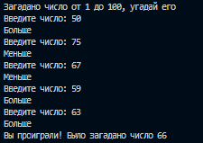
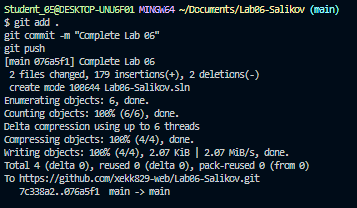

# Практическая работа №6
**ФИО:** Саликов Аскар Рустамович
**Группа:** ИСП-241
**Дата:** 07.11.2026

## Что изучено
- Синтаксис циклов на C#
- Различие между `while` и `do while` (второй обязательно выполнится хотя бы раз)
- `break` и `continue` в циклах

## Скриншоты

